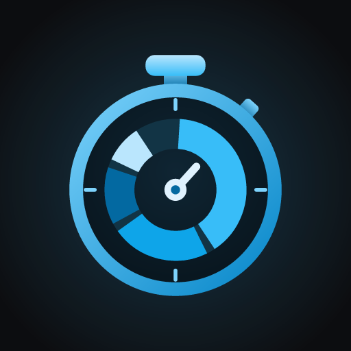

<p align="center"></p>

# Clocked

*Renamed from **AppPulse** in 2.0.1, so it is not confused with Pulse, the suite's notification inbox.*

Offline screen-time tracker for Android, part of the Basalt app suite. Clocked reads Android's own usage
records (UsageStatsManager), rebuilds every app session from them and keeps the history on the phone.

## What's new in 2.2

- **Limit reminders on time.** A 45-minute limit now notifies at 45 minutes, not an hour later. While any
  limit or downtime schedule is on, a silent "Watching your app limits" notification keeps a small
  watcher running that notices app switches within a few seconds (screen on only) and checks again at the
  exact minute the app in front reaches its limit. The card on top of the app appears at that moment and
  again each time you reopen the app after the limit.
- **Correct session times.** Android's "screen on" and "screen off" events were read the wrong way round,
  so on some phones (for example waking straight into an app without a lock screen) the time until the
  next screen-off was lost or a session ended at the wrong moment. Sessions, totals and open/close times
  are now right, and the last week Android still has is rebuilt once after the update.
- The background check and the app now share one set of session rules (with unit tests on both sides),
  so the reminder fires at the same total the app shows.
- Changing a limit during the day notifies again at the new limit.

## What's new in 2.1

- **New logo**: a stopwatch whose face is a donut of usage segments in sky tones.
- **Home-screen widget**: today's screen time, the change against yesterday and your top 3 apps with their
  minutes. Tap it to open Clocked. It refreshes whenever the app syncs and on the background check.
- **Focus tile** in Quick Settings: tap to start a 25-minute focus session, tap again to stop it. While a
  session runs the tile is lit and shows the minutes left. The app and the tile share one session, so the
  focus screen always shows what the tile started or stopped. Long-press the tile to open the focus screen.
- **Launcher shortcuts**: long-press the icon for *Start focus* (starts a 25-minute session) and *App limits*.
- **Downtime**: pick a daily window (for example 23:00–07:00, across midnight) and apps. Opening one of those
  apps in the window gets a gentle "It's downtime" notification, at most once per app every 10 minutes.
  Nothing is blocked. Settings → Downtime, or App limits → Downtime schedule.
- **Weekly summary**: every Monday morning (on by default) a notification with last week's total, the daily
  average, the change from the week before and the top app. Scheduled natively, so it arrives with the app
  closed. Settings → Weekly summary also has *Send a preview now*.
- Settings has a *Quick access* group that explains the widget, the tile and the shortcuts.

## Features

- **Today**: screen time with a daily goal ring, change vs yesterday, unlocks, app opens, longest session,
  usage by hour and the most used apps.
- **Apps**: every app you used today, in the last 7 or 30 days, with search, sort and opens. Each app has a
  detail page: today, 7-day average, 30-day total, a 7-day chart, today by hour, recent sessions, its limit
  and a shortcut to Android's app info.
- **Insights**: overview (total, daily average, busiest day, daily chart, categories, top apps, focus) and a
  day-by-day timeline of sessions.
- **App limits**: a daily limit per app. A notification arrives 5 minutes before and when the limit is
  reached. Optional reminder card drawn over the app (needs "Display over other apps"). Apps are never blocked.
- **Focus sessions**: 15–90 minute sessions with a countdown notification, a completion notification and a
  summary of time spent in other apps during the session.
- **Reports**: CSV or PDF for this week, last 7 days, last 30 days or this month, shared through Android.
- **Accuracy check**: today's per-app numbers next to Android's own totals.
- Usage access onboarding with an "Open settings" button that re-checks when you come back; a clear card
  everywhere data would be while access is missing.
- System, light and dark themes.

## How it works

- Sessions are rebuilt from resume/pause events: one app in front at a time, screen off/lock ends a session,
  sessions over midnight are split between days, the home screen, System UI and Clocked are not counted.
  Unit tests cover these cases (`test/reconstruct_test.dart`).
- Android keeps about a week of events, so Clocked stores sessions in SQLite. It syncs on open and every
  time you return to the app.
- While any limit or downtime schedule is on, a small foreground service (with a silent notification)
  watches for app switches every few seconds while the screen is on, and books an exact check for the
  moment the app in front crosses its threshold. With the screen off it does nothing. A WorkManager job
  every 15 minutes is the fallback (and refreshes the widget). Nothing runs otherwise (apart from the
  Monday summary alarm, if it is on).
- The limit checker (Kotlin, `Sessions.kt`) is a line-for-line port of the Dart session rules, with the
  same test cases on both sides (`android/app/src/test`).
- The running focus session lives natively (shared with the Quick Settings tile); the app imports
  sessions the tile started or stopped when it opens, or immediately if it is already open.

## Permissions — and why

| Permission | Why |
|---|---|
| Usage access (`PACKAGE_USAGE_STATS`) | Reading Android's own app-usage records. Granted by you in Settings. |
| Notifications | Limit reminders, downtime nudges, the focus timer and the weekly summary. |
| Display over other apps (optional) | Only for the reminder card over an app that is past its limit. |
| Run at startup (`RECEIVE_BOOT_COMPLETED`) | Setting the Monday summary alarm again and restarting the limit watcher after a restart. |
| Foreground service (`FOREGROUND_SERVICE`, special use) | The limit watcher, only while limits or downtime are on, so reminders arrive on time. |
| Internet | Only the update check against GitHub releases. |
| Install packages | Opening the Android installer for a downloaded update. |

## Honest limits

- Clocked never blocks an app. Limits and downtime are reminders; you decide.
- Limit reminders and downtime nudges arrive within a few seconds while the limit watcher runs. Its
  notification can be hidden (long-press it, or turn off the "Limit watcher" channel), but if you stop
  the app from the system's task manager or a battery saver kills it, Clocked falls back to WorkManager,
  which Android may delay; opening Clocked starts the watcher again.
- The widget can be up to about 15 minutes behind while the app is closed.
- The widget shows the app's own numbers after each sync; between syncs the background check recomputes
  them natively, which can differ from the app by a minute or so.
- Android keeps roughly a week of usage records. The weekly summary reads last week from Android; "the
  week before" comes from Clocked's saved history or the previous summary, and is left out when neither
  exists. The Monday alarm is inexact, so it can arrive a little after 09:00.
- The Focus tile always starts a 25-minute session; pick other lengths in the app.

## Updates

On every launch (and on return after 15 minutes) the app checks the latest GitHub release of
`muhammadahmad545-code/clocked`, downloads the APK for the phone's ABI, verifies its SHA-256 and opens the
Android installer. Settings has "Check for updates".

## Stack

Flutter 3.47, Riverpod, sqflite, the shared `basalt` package (theme, widgets, updater), Kotlin for
UsageStatsManager/PackageManager/WorkManager/AlarmManager/notifications, the home-screen widget, the
Quick Settings tile and launcher shortcuts, `pdf` and `share_plus` for reports.

## Build

CI (`.github/workflows/build.yml`) runs analyze and tests, builds split-per-ABI release APKs and runs an
emulator smoke test with end-to-end checks (`scripts/smoke.sh`, `scripts/e2e.sh`). Locally:

```sh
flutter pub get
flutter test
flutter build apk --release --split-per-abi
```

Release signing comes from the `RELEASE_KEYSTORE_*` environment variables; without them the build is
debug-signed.
